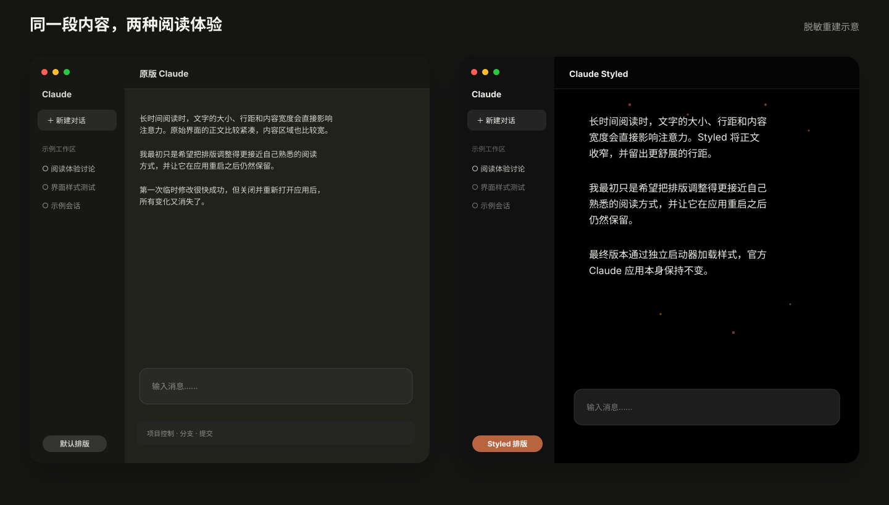
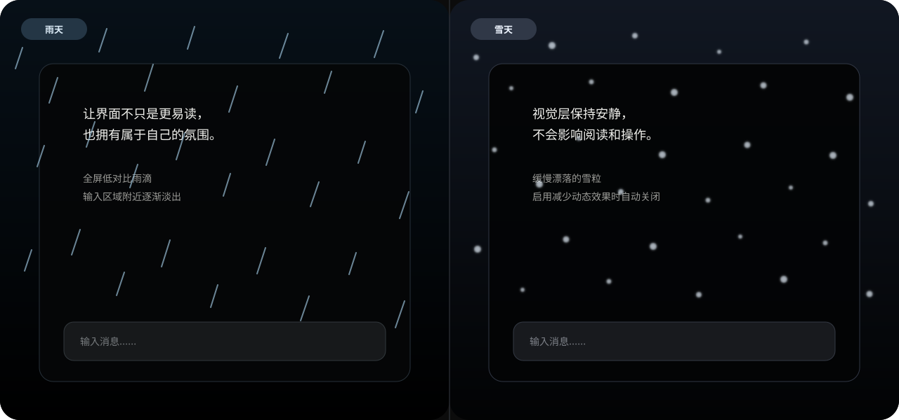

<p align="center">
  
</p>

# Claude Styled

一套面向 macOS Claude Desktop 的本地视觉样式：更舒展的长文本排版、纯黑深色画布、收窄的消息区域，以及低干扰的雨雪氛围。

> **非官方项目。** 本项目与 Anthropic 没有隶属、授权或背书关系。Claude 是其权利人的商标。



## 它改变什么

- 正文使用 16px 系统字体与约 26px 行高；
- 消息区域最大宽度设为 640px；
- 深色内容画布使用纯黑背景；
- 调整标题、列表、引用和行内代码的间距；
- 隐藏仓库与 Pull Request 控件；
- 每次载入随机显示低对比雨天或雪天氛围；
- 启用 macOS“减少动态效果”时自动关闭动画。



## 安装

要求：macOS 13 或更高版本，且官方 Claude Desktop 位于 `/Applications/Claude.app`。

```bash
git clone https://github.com/beforeold/claude-styled.git
cd claude-styled
make install
open "$HOME/Applications/Claude Styled.app"
```

项目只分发源码。`make install` 会在本机组装并临时签名启动器，不需要关闭 Gatekeeper，也不会替换官方 Claude 应用。

以后请从 `~/Applications/Claude Styled.app` 打开。若直接打开官方 Claude，则不会加载这些样式。

## 工作方式


启动器会：

1. 确认官方 Claude Desktop 存在；
2. 只在专属所有权标记有效时更新本地扩展文件；
3. 通过 Claude Desktop 当前版本中的内部启动入口加载这些文件；
4. 打开仍位于 `/Applications/Claude.app` 的官方应用。

它不会修改官方应用包，但会在当前用户的 Claude 应用数据目录中放置 `manifest.json`、`style.css` 和 `weather.js`。

## 隐私与安全

- 扩展没有声明浏览器权限、后台脚本或外部资源；
- 当前 `weather.js` 只创建装饰性 DOM，不读取或上传聊天内容；
- 当前源码不包含遥测，也没有 `fetch`、XHR、WebSocket 或 Beacon 请求；
- `make verify` 会检查脚本与配置语法、常见凭证形态、网络 API、构建产物和签名完整性；
- 源码公开可审计，更新前仍建议查看变更。

内容脚本技术上运行在已登录的 `https://claude.ai/*` 页面中，因此不能把“当前没有读取内容”误解成浏览器层面的绝对隔离。详见 [PRIVACY.md](PRIVACY.md) 与 [SECURITY.md](SECURITY.md)。

## 兼容性与账号说明

Claude Styled 依赖 Claude Desktop 当前版本中的未公开启动入口，Anthropic 更新应用后可能失效。这不是 Anthropic 官方支持的扩展机制；当前代码未涉及账号操作，但本项目无法替用户判断未来兼容性或服务条款风险，也不承诺绝对不存在账号风险。

## 卸载

先完全退出 Claude，然后运行：

```bash
cd claude-styled
make uninstall
```

启动器会移入废纸篓，并且只在所有权标记完全匹配时删除自己创建的本地扩展目录。官方 `/Applications/Claude.app` 不会被删除或修改。

## 自定义与开发

- 排版和颜色：`src/extension/style.css`
- 雨雪视觉：`src/extension/weather.js`
- 启动逻辑：`src/ClaudeStyled`
- 原创图标源文件：`assets/icon.svg`

```bash
make verify  # 完整检查并构建
make build   # 输出 dist/Claude Styled.app
make icon    # 修改 icon.svg 后重新生成 ICNS，需要 librsvg
```

贡献前请阅读 [CONTRIBUTING.md](CONTRIBUTING.md)。

## License

[MIT](LICENSE)
